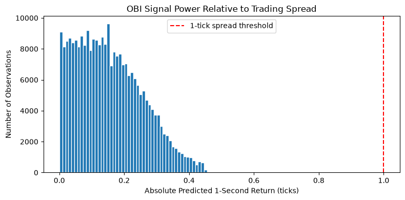
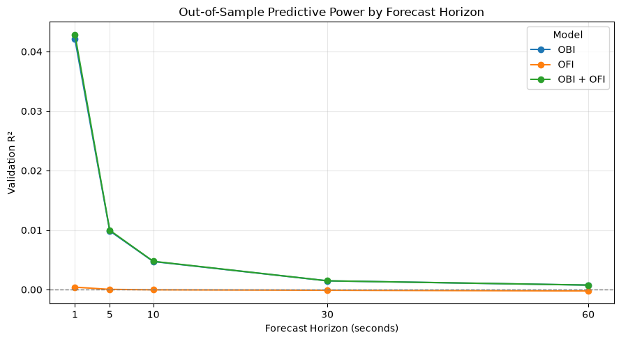
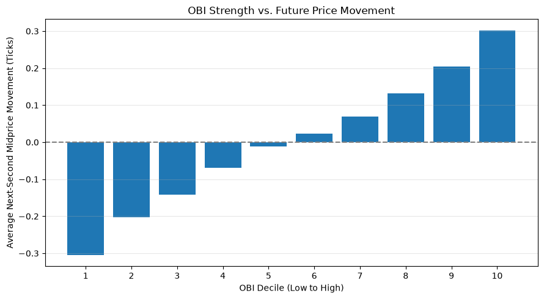
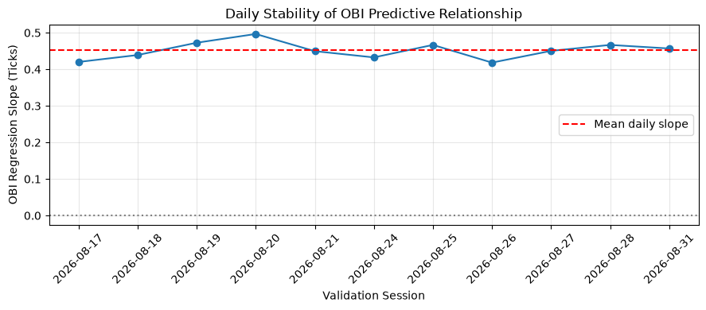

# Order Book Imbalance in ES Futures: Predictable, but Not Tradable

**FINM 37000 — Group 2**

We used Databento's CME top-of-book data for E-mini S&P 500 futures (`ES`) to test whether order book imbalance (OBI) and order flow imbalance (OFI) predict short-horizon price moves. **They do, but the predicted moves are too small to trade.** On 11 held-out trading sessions, a one-variable OBI model explains about 4% of the variance of the next one-second midprice change. Its direction is stable every day, and its forecasts are well calibrated. However, its largest forecast is 0.46 ticks, and a market-order round trip costs a full 1-tick spread before fees. **Not one of 267,072 out-of-sample predictions clears that cost.**

We started out planning to turn the strongest signal into a backtested trading strategy. Because no signal beats the spread, a strategy that crosses the spread would lose money on average. The project instead reports the signal research and explains why the gap between statistical and economic significance appears.



## Key Findings

The 43-session sample (July 1 to August 31, 2026) is split chronologically by session: models are fit on the first 32 sessions and evaluated on the last 11 (Aug 17–31).

| Horizon | OBI R² | OFI R² | OBI + OFI R² |
|---|---|---|---|
| 1 s | 0.0421 | 0.0004 | 0.0429 |
| 5 s | 0.0099 | 0.0000 | 0.0100 |
| 10 s | 0.0047 | −0.0000 | 0.0047 |
| 30 s | 0.0015 | −0.0001 | 0.0015 |
| 60 s | 0.0008 | −0.0002 | 0.0008 |

*Validation (out-of-sample) R² of linear regressions of the forward midprice change in ticks.*

1. **OBI is the signal.** The resting-size imbalance at the best bid and ask is by far the strongest predictor. Average next-second returns rise steadily across OBI deciles, from −0.31 ticks in the lowest decile to +0.30 ticks in the highest.
2. **It decays within seconds.** R² falls by three-quarters between 1 and 5 seconds and is near zero at one minute. The information is used up almost as soon as it is posted.
3. **OFI adds almost nothing.** On its own, OFI's R² is close to zero. Adding it to OBI raises the 1-second R² from 0.0421 to 0.0429, and its decile pattern is not monotonic. On the single-day OFI study, no OFI regression coefficient was statistically significant (all HAC |t| < 1.3).
4. **Microprice is OBI in disguise.** Microprice minus midprice equals (spread ÷ 2) × OBI exactly. On July 1, 95% of ES book states had a one-tick spread, and across the 43 sessions the two are 0.997 correlated and have practically the same R² (0.0418 vs 0.0421).
5. **The relationship is stable and well calibrated.** The 1-second OBI slope is positive in all 11 validation sessions (mean 0.452 ticks per unit of OBI, s.d. 0.024). Predicted and realized returns line up across prediction deciles: the top bin predicts +0.310 ticks and realizes +0.301.
6. **It doesn't pay.** The mean absolute 1-second forecast is 0.155 ticks (about $1.94 per contract), against a 1-tick ($12.50) round-trip cost.







## What We Built

- **Data pipeline.** A single command downloads `GLBX.MDP3` `mbp-1` records for `ES.v.0` (the front contract by volume) one regular-hours session at a time. It cleans and validates them and writes one Parquet file per session. The cleaning step drops crossed books and out-of-session rows, marks contract rolls and casts unsigned sizes to signed integers. `validate()` checks every schema invariant, and the pipeline has pytest coverage ([`docs/data-schema.md`](docs/data-schema.md)).
- **Signals** (`features.py`, `ofi_analysis.py`). The signals are OBI, microprice and best-level OFI (Cont, Kukanov and Stoikov), aggregated to a one-second panel. Each signal is measured at the end of a second, and forward returns start at that same boundary. Returns never cross a session or contract boundary.
- **Evaluation.** We use chronological train/validation splits by whole session, with decile cutoffs taken from training data only. The evaluation also covers daily slope stability, calibration, and a comparison against the spread.

September 2026 was held out for a final strategy backtest. Since no signal survived the spread on the validation data, that backtest was never run and the September data was never used.

## What the results mean

- **The signal decays fast.** Predictive power is concentrated at the shortest horizons and fades quickly as the horizon lengthens, which is exactly where spread costs matter most.
- **Predictability is not profitability.** A statistically significant signal only becomes a strategy if its expected gain exceeds the cost of crossing the bid-ask spread. In ES the spread is one tick (0.25 index points) in about 95% of book updates in our development session.
- **Microprice adds little beyond OBI at the top of the book.** With our definitions, microprice minus mid equals half the spread times OBI, so the two signals are almost mechanically related. Testing for information beyond static imbalance requires a different signal, such as order flow imbalance.
- **Price changes are discrete.** ES moves in 0.25-point ticks, so many short-horizon mid-price changes are exactly zero. We measure future moves in ticks so they compare directly with the cost of crossing the spread.

## Limitations and Future Work

The cost test assumes a fixed 1-tick spread and aggressive (market-order) execution, and it ignores exchange fees, latency and queue position. These omissions only make the conclusion stronger for aggressive trading. They do not rule out **passive** strategies, which earn the spread rather than pay it. Using OBI to decide when to post or cancel limit orders, with fill and adverse-selection modelling, is the natural next step. Other extensions are non-linear models, deeper book levels (`mbp-10`) and testing the robustness of the results on `NQ`.

## How to Run

Requires [`uv`](https://docs.astral.sh/uv/) and a Databento API key. Everything used is covered by the CME Plus plan; downloads abort if Databento quotes any cost.

```bash
git clone https://github.com/elliotchung/finm37000-grp-2.git
cd finm37000-grp-2
uv sync                       # installs dependencies, including JupyterLab

cp .env.example .env          # Windows PowerShell: Copy-Item .env.example .env
# edit .env and set DATABENTO_API_KEY=<your key>   (.env is git-ignored)

uv run pytest                 # no API key needed

# Download and clean the 43 in-sample sessions (Jul 1 – Aug 31, 2026; about 18 GB uncompressed)
uv run python -m finm37000_grp2 --sample in_sample
# Optional: one development session (2026-10-08) for the preliminary notebooks
uv run python -m finm37000_grp2 --sample dev

uv run jupyter lab            # then open notebooks/
```

Raw downloads are cached in `data/raw/`, and clean sessions are written to `data/processed/ES/{YYYY-MM-DD}.parquet` (both git-ignored). Sessions already on disk are skipped, so an interrupted download resumes where it stopped (`--force` redoes everything). The other sample names are `research` (Jul–Sep) and `out_of_sample` (Sep), which is unused. `--offline` writes synthetic data to `data/processed/offline/` to check the code without a key; the notebooks do not read it.

| Notebook | Data | Produces |
|---|---|---|
| `multi_session_analysis.ipynb` | `in_sample` | **All headline results:** model comparison, R² by horizon, deciles, calibration, spread test and daily stability. Caches the one-second panel to `data/processed/ES/in_sample_signals.parquet`. |
| `signal_analysis.ipynb` | `dev` | Preliminary single-day OBI and microprice correlations, and price moves vs spread |
| `ofi_research.ipynb` | `dev` (change `SAMPLE` in the first code cell) | Single-day OFI construction, leakage checks and HAC regressions |

To run a notebook headlessly, use `uv run jupyter nbconvert --to notebook --execute --inplace notebooks/<name>.ipynb`. The multi-session notebook processes each session separately to limit memory use. Building the panel takes several minutes. The figures in `docs/figures/` were exported from its outputs.

## Data and pipeline notes

- **Data:** CME Globex dataset `GLBX.MDP3` from Databento, schema `mbp-1` (top-of-book updates and trades), symbol `ES.v.0` (front contract by volume), regular trading hours 08:30-15:15 CT.
- **Contract rolls:** we use `ES.v.0` rather than `ES.c.0` because the calendar roll stays on the expiring contract after its liquidity has gone. A roll shows up as a change in `instrument_id`, and returns are never computed across one.
- **Samples:** a one-session development sample (2026-10-08, about 6.2 M records) and a research sample from 2026-07-01 to 2026-09-30 (64 sessions, about 349 M records, about 28 GB uncompressed).
- **Processing:** each session is downloaded, cached in `data/raw/`, cleaned and validated, and written as Parquet to `data/processed/ES/`. Sessions already processed are skipped, so an interrupted run resumes where it stopped. The clean-data schema is documented in [`docs/data-schema.md`](docs/data-schema.md).
- **Cost:** downloads abort if Databento estimates any cost; everything we use is covered by the CME Plus plan.

## Repository Layout

```text
.
├── src/finm37000_grp2/
│   ├── config.py           # paths, Databento request, sample periods
│   ├── pipeline.py         # download → clean → validate → Parquet, per session
│   ├── data/               # ingest.py, clean.py, synthetic.py
│   ├── features.py         # midprice, spread, OBI, microprice
│   └── ofi_analysis.py     # event OFI, 1-second panel, splits, regressions
├── notebooks/              # analysis notebooks (table above)
├── tests/                  # pytest suite
├── docs/                   # data schema, figures, course and planning docs
└── PLANNING.md             # original project plan and data-specification notes
```

## Team

Elliot Chung ([@elliotchung](https://github.com/elliotchung)), Vidhi Jain ([@vidhijain28](https://github.com/vidhijain28)), Divya Dehlan ([@dehlandivya](https://github.com/dehlandivya)), Kayla Hammonds ([@khammonds530-max](https://github.com/khammonds530-max)).
